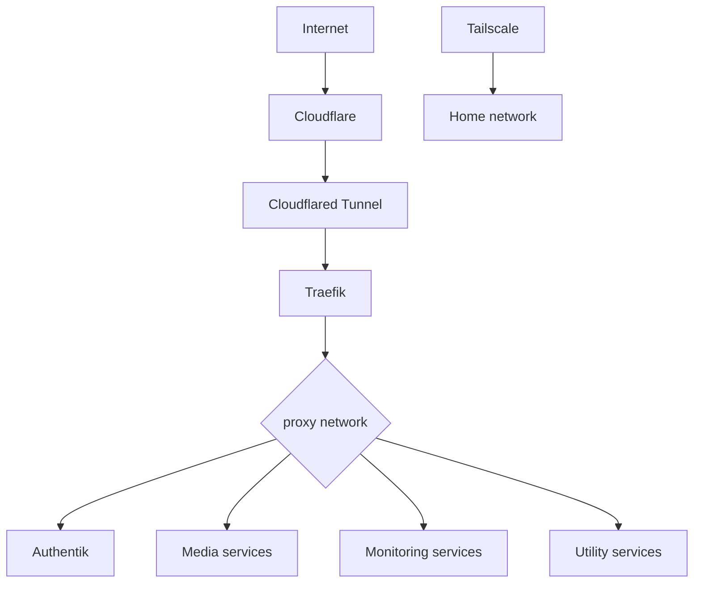

---
hide:
  - toc
---
# :material-network: Homelab Networking Architecture

The homelab uses Docker networking, Traefik, Cloudflare Tunnel, and Tailscale to keep service routing predictable while minimizing direct exposure.

!!! info ":material-source-branch: Source of Truth"
    The current `ubuntu_Desktop` Compose files are authoritative. Network membership is defined per service, so this page avoids hard-coded subnets and static membership lists that can drift over time.

## :material-sitemap: Network Model

The shared `proxy` network is the primary cross-stack network. The networking stack declares it as an external Docker bridge, and other stacks attach only the services that need Traefik or cross-stack communication.



## :material-web: Proxy Network

The `proxy` network is an externally managed Docker bridge named `proxy`.

Its jobs are simple:

- allow Traefik to reach routed containers by container name
- provide shared connectivity where services in separate Compose projects need to communicate
- avoid publishing unnecessary application ports directly on the host

!!! warning ":material-alert: Do Not Treat proxy as Public Internet"
    Joining `proxy` does not automatically expose a container. Exposure still depends on Traefik routing, middleware, and Cloudflare configuration. Services should only join networks they actually need.

## :material-cloud-lock: External Web Access

Public web traffic follows this path:

1. A request reaches Cloudflare.
2. Cloudflare Tunnel carries it to the homelab without requiring inbound port forwarding.
3. Traefik matches the hostname and routes the request to the target container.
4. The applicable middleware chain handles authentication, threat protection, headers, rate limiting, or other policy before the request reaches the application.

The networking stack currently includes **Cloudflared**, **Traefik**, **Tailscale**, **error pages**, and a **Whoami** test service.

## :material-shield-lock: Security Path

The security stack currently includes **Authentik**, **CrowdSec**, and **Anubis**. These services participate in request protection rather than relying on a separate hard-coded `security-net` topology.

Typical request protection can include:

- **CrowdSec** for malicious-client detection and blocking
- **Anubis** for bot/challenge protection where enabled
- **Authentik** for SSO on protected applications
- **Traefik middleware** for redirects, security headers, compression, and rate limiting

!!! tip ":material-order-bool-ascending-variant: Middleware Order Matters"
    Keep security middleware ordering intentional. CrowdSec should reject known bad traffic before more expensive authentication or bot-challenge work whenever the route design allows it.

## :material-vpn: Tailscale

Tailscale provides a second access path that is separate from the public web path. It is useful for private administration and reaching home-network addresses without publishing those services through Cloudflare.

| Method | Best for |
| --- | --- |
| **Cloudflare Tunnel + Traefik** | Selected browser-accessible applications |
| **Tailscale** | Private administration and home-network access |

## :material-docker: Container-to-Container Routing

Prefer container names over fixed container IP addresses. Docker DNS keeps names stable even when container addresses change.

```text
sonarr:8989
radarr:7878
prowlarr:9696
sabnzbd:8080
```

The exact port depends on the application, but the principle is the same: when two containers share the required Docker network, route to the service name rather than pinning an IP.

## :material-plus-circle: Adding a New Routed Service

When adding a web application:

1. Connect it to `proxy` if Traefik must reach it.
2. Add the required Traefik router/service labels or dynamic configuration.
3. Apply the appropriate middleware chain.
4. Keep application ports un-published unless host/LAN access specifically requires them.
5. Verify the route from both the intended local and remote access paths.
6. Add the service to the wiki after the deployment is working.

??? example "Minimal network declaration"
    ```yaml
    services:
      myservice:
        image: example/myservice:1.2.3
        networks:
          - proxy

    networks:
      proxy:
        external: true
        name: proxy
    ```

## :material-console: Useful Network Commands

```bash
# List Docker networks
docker network ls

# Inspect the shared proxy network
docker network inspect proxy

# Inspect a container's network membership
docker inspect <container>

# Test name resolution from a container
docker exec <container> getent hosts <target-container>
```

!!! warning ":material-delete-alert: Be Careful with Pruning"
    `docker network prune` can remove unused networks. Inspect the environment first rather than using prune as a routine troubleshooting step.

## :material-check-decagram: Networking Principles

- **Least privilege:** connect a service only to networks it needs.
- **Container-name routing:** avoid fixed Docker IP dependencies.
- **Single ingress layer:** route selected web traffic through Traefik.
- **Layered protection:** combine Cloudflare, CrowdSec, Anubis, Authentik, and Traefik middleware as appropriate.
- **Private administration:** use Tailscale when a service does not need public web exposure.
- **Compose as truth:** check the current service files before relying on documentation for exact network membership.

Your network documentation describes the architecture, while Compose describes the exact wiring. That separation keeps this page useful even as the homelab evolves.
